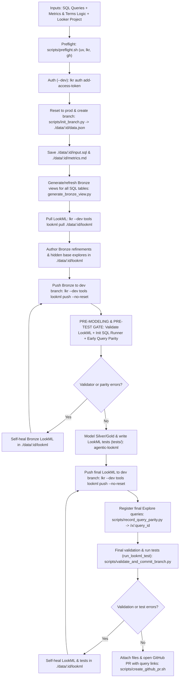

# Agentic End-to-End SQL-to-LookML Workflow (`agentic-lookml-workflow`)



## Bundled scripts

All workflow helper scripts live in `skills/agentic-lookml-workflow/scripts/`:

- [preflight.sh](scripts/preflight.sh) checks and installs `uv` if missing, installs `lkr-dev-cli[tools,code-mode,parse]` via `uv tool install`, and verifies `gh auth status` (passing `GH_TOKEN` / `GITHUB_TOKEN` directly to `gh`).
- [init_branch.py](scripts/init_branch.py) runs in `lkr code-mode sandbox --dev-mode` to fetch `me()['id']` and `git_production_branch_name`, run `reset_project_to_production`, create branch `YYYYMMDD_HHMMSS_mmm_<looker_user_id>` from the production ref, and return the base `data.json` payload.
- [init_sql_queries.py](scripts/init_sql_queries.py) runs in `lkr code-mode sandbox --dev-mode` to split multi-statement SQL in `input.sql`, create SQL Runner queries via `create_sql_query`, and populate `data.json["queries"]` with `sql_query_id` and `sql_runner_url` (`{BASE_URL}/sql/{sql_id}`).
- [record_query_parity.py](scripts/record_query_parity.py) runs in `lkr code-mode sandbox --dev-mode` after LookML modeling to register Looker explore queries via `create_query`, store `query_id`, `query_slug`, and `explore_url` (`{BASE_URL}/x/{query_slug}`), and compare row outputs between SQL Runner (`run_sql_query`) and Looker (`run_inline_query`).
- [verify_lookml_validation.py](scripts/verify_lookml_validation.py) standalone script and PR check gate running `validate_project` and `run_lookml_test` via the Looker API, ensuring all syntax and LookML data tests pass before query parity is evaluated.
- [verify_sql_lookml_parity.py](scripts/verify_sql_lookml_parity.py) standalone script and PR check that evaluates numerical parity between SQL Runner queries and Looker explore queries across all registered queries in `data.json`.
- [validate_and_commit_branch.py](scripts/validate_and_commit_branch.py) runs in `lkr code-mode sandbox --dev-mode` to validate the project (`validate_project`), execute all LookML data tests (`run_lookml_test`), block commits if tests fail, and commit the branch via the Looker API (`commit`).
- [create_github_pr.sh](scripts/create_github_pr.sh) attaches `./data/:id/input.sql`, `./data/:id/metrics.md`, `./data/:id/compare_initial.json`, and `./data/:id/compare_post_refactor.json` via `gh gist create`, formats a markdown table of interactive SQL Runner (`/sql/:sql_id`) and Looker Explore (`/x/:query_id`) links, writes attachment URLs into `./data/:id/data.json`, and opens the GitHub PR against `git_production_branch_name` via `gh pr create`.

## Workflow steps

- Collect inputs: SQL queries (inline or `.sql` files), metrics and terms logic (business definitions, common measures, and dimensions/filters used for common analysis), and the target Looker project (`BASE_URL`, `PROJECT_ID`, `MODEL_NAME`, `CONNECTION_NAME`).
- Run preflight checks ([scripts/preflight.sh](scripts/preflight.sh)) and authenticate in development mode (`--dev` is mandatory; never run in production):
  ```bash
  bash skills/agentic-lookml-workflow/scripts/preflight.sh
  lkr --client-id="$LOOKERSDK_CLIENT_ID" --client-secret="$LOOKERSDK_CLIENT_SECRET" --base-url="$BASE_URL" --dev auth add-access-token
  ```
- Reset the developer workspace to production, create branch `YYYYMMDD_HHMMSS_mmm_<looker_user_id>` off the production ref with [scripts/init_branch.py](scripts/init_branch.py), and extract `data.json`, `input.sql`, and `metrics.md` into `./data/$RUN_ID/`:
  ```bash
  BRANCH_JSON=$(lkr --base-url="$BASE_URL" --dev code-mode sandbox --dev-mode \
    --file=skills/agentic-lookml-workflow/scripts/init_branch.py \
    --var project_id="$PROJECT_ID" \
    --var ts_utc="$(date -u +%Y%m%d_%H%M%S_%3N)")
  RUN_ID=$(echo "$BRANCH_JSON" | jq -r '.run_id')
  mkdir -p "./data/$RUN_ID/lookml"
  echo "$BRANCH_JSON" > "./data/$RUN_ID/data.json"
  cp "$SQL_FILE" "./data/$RUN_ID/input.sql"
  cp "$METRICS_FILE" "./data/$RUN_ID/metrics.md"
  ```
- Initialize SQL Runner queries and capture `/sql/:sql_id` links:
  ```bash
  lkr --base-url="$BASE_URL" --dev code-mode sandbox --dev-mode \
    --file=skills/agentic-lookml-workflow/scripts/init_sql_queries.py \
    --var sql_file="./data/$RUN_ID/input.sql" \
    --var data_json_path="./data/$RUN_ID/data.json" \
    --var base_url="$BASE_URL" \
    --var model_name="$MODEL_NAME"
  ```
- Run [generate-view-from-table](../generate-view-from-table/SKILL.md) ([generate_bronze_view.py](../generate-view-from-table/scripts/generate_bronze_view.py)) for all physical tables in the SQL query every time so every `bronze/:table.view.lkml` is up to date on the branch, then pull all LookML into `./data/$RUN_ID/lookml`:
  ```bash
  lkr --base-url="$BASE_URL" --dev code-mode sandbox --dev-mode \
    --file=skills/generate-view-from-table/scripts/generate_bronze_view.py \
    --var project_id="$PROJECT_ID" \
    --var model_name="$MODEL_NAME" \
    --var connection_name="$CONNECTION_NAME" \
    --var schema_name="$SCHEMA_NAME" \
    --var table_name="$TABLE_NAMES"
  lkr --base-url="$BASE_URL" --dev tools lookml pull "./data/$RUN_ID/lookml" --project-id="$PROJECT_ID"
  ```
- Author Bronze refinements (`bronze/:table.refinement.lkml`) with primary keys, descriptions, single-table dimensions and measures, and hidden base explores (`bronze/explores/:table_base.explore.lkml`), then push Bronze files to the dev branch:
  ```bash
  lkr --base-url="$BASE_URL" --dev tools lookml push "./data/$RUN_ID/lookml" --project-id="$PROJECT_ID" --no-reset
  ```
- **Pre-Modeling & Pre-Test Verification Gate** (execute immediately after Bronze generation and *before* writing tests or finalizing Silver modeling):
  1. Initialize SQL Runner queries via `init_sql_queries.py` to capture `/sql/:sql_id` links:
     ```bash
     lkr --base-url="$BASE_URL" --dev code-mode sandbox --dev-mode \
       --file=skills/agentic-lookml-workflow/scripts/init_sql_queries.py \
       --var sql_file="./data/$RUN_ID/input.sql" \
       --var data_json_path="./data/$RUN_ID/data.json" \
       --var base_url="$BASE_URL" \
       --var model_name="$MODEL_NAME"
     ```
  2. Run LookML Validator gate ([scripts/verify_lookml_validation.py](scripts/verify_lookml_validation.py)) to ensure Bronze LookML compiles cleanly without syntax or reference errors:
     ```bash
     lkr --base-url="$BASE_URL" --dev code-mode sandbox --dev-mode \
       --file=skills/agentic-lookml-workflow/scripts/verify_lookml_validation.py \
       --var project_id="$PROJECT_ID"
     ```
  3. Formulate initial Looker queries and verify early parity against SQL Runner via [scripts/record_query_parity.py](scripts/record_query_parity.py) before writing any tests:
     ```bash
     lkr --base-url="$BASE_URL" --dev code-mode sandbox --dev-mode \
       --file=skills/agentic-lookml-workflow/scripts/record_query_parity.py \
       --var data_json_path="./data/$RUN_ID/data.json" \
       --var base_url="$BASE_URL" \
       --var inline_queries_json="$INLINE_QUERIES_JSON"
     ```
- Model Silver explores, cross-view `*_fields`, and author LookML data tests (`tests/bronze/` and `tests/silver/`) in `./data/$RUN_ID/lookml` following [agentic-lookml](../agentic-lookml/SKILL.md) (using the verified immutable baseline values from the parity gate), and re-run compare:
  ```bash
  lkr parse sql-lookml-compare --sql-file "./data/$RUN_ID/input.sql" --path "./data/$RUN_ID/lookml" --output "./data/$RUN_ID/compare_post_refactor.json"
  ```
- Push final LookML edits to the active developer branch with `--no-reset`:
  ```bash
  lkr --base-url="$BASE_URL" --dev tools lookml push "./data/$RUN_ID/lookml" --project-id="$PROJECT_ID" --no-reset
  ```
- Register final Looker explore queries in development mode, capture `/x/:query_id` short URLs, and record final parity status:
  ```bash
  lkr --base-url="$BASE_URL" --dev code-mode sandbox --dev-mode \
    --file=skills/agentic-lookml-workflow/scripts/record_query_parity.py \
    --var data_json_path="./data/$RUN_ID/data.json" \
    --var base_url="$BASE_URL" \
    --var inline_queries_json="$INLINE_QUERIES_JSON"
  ```
- Validate syntax AND execute all LookML data tests via [scripts/validate_and_commit_branch.py](scripts/validate_and_commit_branch.py) (self-healing any validation or test errors before committing), and run [scripts/create_github_pr.sh](scripts/create_github_pr.sh) to attach files, include the interactive query links in the PR description, and open the GitHub PR:
  ```bash
  lkr --base-url="$BASE_URL" --dev code-mode sandbox --dev-mode \
    --file=skills/agentic-lookml-workflow/scripts/validate_and_commit_branch.py \
    --var project_id="$PROJECT_ID" \
    --var commit_message="feat(lookml): refactor SQL queries ($RUN_ID)"

  bash skills/agentic-lookml-workflow/scripts/create_github_pr.sh "./data/$RUN_ID"
  ```

## Automated GitHub PR checks (`.github/workflows/lookml-pr-checks.yml`)

When PRs containing LookML changes or `./data/*/data.json` session files are created or updated, GitHub Actions executes two sequential gates:

1. **`lookml-validator` (LookML Validator & Data Tests)**:
   - Runs [scripts/verify_lookml_validation.py](scripts/verify_lookml_validation.py) via `lkr --base-url="$LOOKERSDK_BASE_URL" --dev code-mode sandbox --dev-mode`.
   - Executes Looker's `validate_project` and `run_lookml_test` on the branch.
   - Fails immediately if syntax errors, broken references, or LookML data tests fail.
2. **`sql-lookml-parity` (SQL-to-LookML Parity Check)**:
   - Configured with `needs: [lookml-validator]` so it only runs if the LookML validator passes.
   - Runs [scripts/verify_sql_lookml_parity.py](scripts/verify_sql_lookml_parity.py) via `lkr --base-url="$LOOKERSDK_BASE_URL" --dev code-mode sandbox --dev-mode`.
   - Executes each SQL Runner query (`/sql/:sql_id`) and corresponding Looker explore query (`/x/:query_id`), asserting 100% numerical parity.
