# Agentic end-to-end SQL-to-LookML workflow (`agentic-lookml-workflow`)

```mermaid
flowchart TD
    Start["Inputs: SQL Queries + Metrics & Terms Logic + Looker Project"] --> Preflight["Preflight: scripts/preflight.sh (uv, lkr, gh)"]
    Preflight --> Auth["Auth (--dev): lkr auth add-access-token"]
    Auth --> InitBranch["Reset to prod & create branch: scripts/init_branch.py -> ./data/:id/data.json"]
    InitBranch --> ExtractFiles["Save ./data/:id/input.sql, ./data/:id/metrics.md & initialize ./data/:id/summary.md"]
    ExtractFiles --> GenBronze["Generate/refresh Bronze views for all SQL tables: generate_bronze_view.py (log to summary.md)"]
    GenBronze --> PullLookML["Pull LookML & baseline snapshots: lookml pull + lkr parse lookml snapshot -u"]
    PullLookML --> GenBronzeRefinements["Deconstruct query, identify patterns & author Bronze refinements in ./data/:id/lookml (log to summary.md)"]
    GenBronzeRefinements --> PushBronze["Push Bronze to dev branch: lkr --dev tools lookml push --no-reset"]
    PushBronze --> PreGate["PRE-MODELING & PRE-TEST GATE: Validate LookML + Init SQL Runner + Early Query Parity"]
    PreGate --> PreGateCheck{"Validator or parity errors?"}
    PreGateCheck -- "Yes" --> FixBronze["Log 'Validation failed' & 'Updating LookML' to summary.md; self-heal Bronze"]
    FixBronze --> PushBronze
    PreGateCheck -- "No" --> RunAgentic["Model Silver/Gold & write LookML tests (tests/) in ./data/:id/lookml (log to summary.md)"]
    RunAgentic --> SnapshotGate["Check snapshots: lkr parse lookml snapshot --allow-additions -> snapshot_check.json"]
    SnapshotGate --> PushFinal["Push final LookML to dev branch: lkr --dev tools lookml push --no-reset"]
    PushFinal --> TargetTests["Target new/additional tests via lkr code-mode: run_lookml_test(file_id=..., test=...)"]
    TargetTests --> RecordParity["Register final Explore queries: scripts/record_query_parity.py -> /x/:query_id"]
    RecordParity --> ValidateCommit["Final validation & targeted tests: scripts/validate_and_commit_branch.py"]
    ValidateCommit --> ValidCheck{"Validation or test errors?"}
    ValidCheck -- "Yes" --> FixFinal["Log failure & fix to summary.md; self-heal LookML & tests"]
    FixFinal --> PushFinal
    ValidCheck -- "No" --> OpenPR["Attach summary.md & files, open GitHub PR with query links: scripts/create_github_pr.sh"]
```



## Bundled scripts

All workflow helper scripts live in `skills/agentic-lookml-workflow/scripts/`:

- [preflight.sh](scripts/preflight.sh) checks and installs `uv` if missing, installs `lkr-dev-cli[tools,code-mode,parse]` via `uv tool install`, and verifies `gh auth status` (passing `GH_TOKEN` / `GITHUB_TOKEN` directly to `gh`).
- [init_branch.py](scripts/init_branch.py) runs in `lkr code-mode sandbox --dev-mode` to fetch `me()['id']` and `git_production_branch_name`, run `reset_project_to_production`, create branch `YYYYMMDD_HHMMSS_mmm_<looker_user_id>` from the production ref, and return the base `data.json` payload.
- [init_sql_queries.py](scripts/init_sql_queries.py) runs in `lkr code-mode sandbox --dev-mode` to split multi-statement SQL in `input.sql`, create SQL Runner queries via `create_sql_query`, and populate `data.json["queries"]` with `sql_query_id` and `sql_runner_url` (`{BASE_URL}/sql/{sql_id}`).
- [record_query_parity.py](scripts/record_query_parity.py) runs in `lkr code-mode sandbox --dev-mode` to register Looker explore queries via `create_query` (when `inline_queries_json` is provided), store `query_id`, `query_slug`, and `explore_url` (`{BASE_URL}/x/{query_slug}`), and compare row outputs between SQL Runner (`run_sql_query`) and Looker (`run_inline_query` / `run_query`) both locally and in CI.
- [validate_and_commit_branch.py](scripts/validate_and_commit_branch.py) runs in `lkr code-mode sandbox --dev-mode` to validate the project (`validate_project`), execute targeted LookML data tests (`run_lookml_test` filtered by `test_names` / `file_ids`, or skipped via `skip_tests="true"`), block commits if any test fails, and optionally commit the branch via the Looker API (`commit`) when `commit_message` is provided.
- [create_github_pr.sh](scripts/create_github_pr.sh) runs `lkr parse lookml snapshot --allow-additions` if `snapshot_check.json` is not yet generated, attaches `./data/:id/summary.md`, `./data/:id/input.sql`, `./data/:id/metrics.md`, `./data/:id/compare_initial.json`, `./data/:id/compare_post_refactor.json`, and `./data/:id/snapshot_check.json` via `gh gist create`, embeds `summary.md`, the snapshot review status, and the interactive SQL Runner (`/sql/:sql_id`) and Looker Explore (`/x/:query_id`) link table in the PR description, writes attachment URLs into `./data/:id/data.json`, and opens the GitHub PR against `git_production_branch_name` via `gh pr create` (requesting reviewers when material snapshot changes are detected).

## Workflow steps

- Collect inputs: SQL queries (inline or `.sql` files), metrics and terms logic (business definitions, common measures, and dimensions/filters used for common analysis), and the target Looker project (`BASE_URL`, `PROJECT_ID`, `MODEL_NAME`, `CONNECTION_NAME`).
- Run preflight checks ([scripts/preflight.sh](scripts/preflight.sh)) and authenticate in development mode (`--dev` is mandatory; never run in production):
  ```bash
  bash skills/agentic-lookml-workflow/scripts/preflight.sh
  lkr --client-id="$LOOKERSDK_CLIENT_ID" --client-secret="$LOOKERSDK_CLIENT_SECRET" --base-url="$BASE_URL" --dev auth add-access-token
  ```
- Reset the developer workspace to production, create branch `YYYYMMDD_HHMMSS_mmm_<looker_user_id>` off the production ref with [scripts/init_branch.py](scripts/init_branch.py), and initialize `data.json`, `input.sql`, `metrics.md`, and `summary.md` inside `./data/$RUN_ID/`:
  ```bash
  BRANCH_JSON=$(lkr --base-url="$BASE_URL" --dev code-mode sandbox --dev-mode \
    --file=skills/agentic-lookml-workflow/scripts/init_branch.py \
    --var project_id="$PROJECT_ID" \
    --var ts_utc="$(date -u +%Y%m%d_%H%M%S_%3N)")
  RUN_ID=$(echo "$BRANCH_JSON" | jq -r '.run_id')
  mkdir -p "./data/$RUN_ID/lookml"
  echo "$BRANCH_JSON" > "./data/$RUN_ID/data.json"
  cp "$SQL_FILE" "./data/$RUN_ID/input.sql"
  cp "$METRICS_FILE" "./data/$RUN_ID/metrics.md"
  echo "# Agentic LookML operations summary (\`$RUN_ID\`)" > "./data/$RUN_ID/summary.md"
  ```
- Throughout the session, append high-level operation milestones to `./data/$RUN_ID/summary.md` as defined in [agentic-lookml](../agentic-lookml/SKILL.md):
  1. Generating base views (`bronze/:table.view.lkml`)
  2. Deconstructing query to canonical form (including the modeling decisions made and, whenever a derived table or Gold explore is used, the specific reason why the query could not be reduced further into a flat Canonical Looker Query)
  3. Query patterns from original query (for example, single-table with union: `simple_single_table`, `unions`)
  4. Writing LookML (Bronze refinements, hidden base explores, Silver and Gold views and explores)
  5. Validation failures (`Validation failed: ...`) and self-healing updates (`Updating LookML: ...`)
  6. Writing and targeting LookML tests (`tests/bronze/` and `tests/silver/`)
- Run [generate-view-from-table](../generate-view-from-table/SKILL.md) ([generate_bronze_view.py](../generate-view-from-table/scripts/generate_bronze_view.py)) for all physical tables in the SQL query every time so every `bronze/:table.view.lkml` is up to date on the branch, pull all LookML into `./data/$RUN_ID/lookml`, and log the base view generation in `./data/$RUN_ID/summary.md`:
  ```bash
  lkr --base-url="$BASE_URL" --dev code-mode sandbox --dev-mode \
    --file=skills/generate-view-from-table/scripts/generate_bronze_view.py \
    --var project_id="$PROJECT_ID" \
    --var model_name="$MODEL_NAME" \
    --var connection_name="$CONNECTION_NAME" \
    --var schema_name="$SCHEMA_NAME" \
    --var table_name="$TABLE_NAMES"
  lkr --base-url="$BASE_URL" --dev tools lookml pull "./data/$RUN_ID/lookml" --project-id="$PROJECT_ID"
  lkr parse lookml snapshot --path "./data/$RUN_ID/lookml" -u
  lkr parse sql-lookml-compare --sql-file "./data/$RUN_ID/input.sql" --path "./data/$RUN_ID/lookml" --output "./data/$RUN_ID/compare_initial.json"
  ```
- Deconstruct the SQL query to canonical form, identify the matched query patterns from the original query, author Bronze refinements (`bronze/:table.refinement.lkml`) and hidden base explores (`bronze/explores/:table_base.explore.lkml`), record these steps in `./data/$RUN_ID/summary.md`, and push Bronze files to the dev branch:
  ```bash
  lkr --base-url="$BASE_URL" --dev tools lookml push "./data/$RUN_ID/lookml" --project-id="$PROJECT_ID" --no-reset
  ```
- Execute the pre-modeling and pre-test verification gate immediately after Bronze generation and before writing tests or finalizing Silver modeling:
  1. Initialize SQL Runner queries via `init_sql_queries.py` to capture `/sql/:sql_id` links in `data.json`:
     ```bash
     UPDATED_DATA=$(lkr --base-url="$BASE_URL" --dev code-mode sandbox --dev-mode \
       --file=skills/agentic-lookml-workflow/scripts/init_sql_queries.py \
       --var raw_sql="$(cat "./data/$RUN_ID/input.sql")" \
       --var data_json="$(cat "./data/$RUN_ID/data.json")" \
       --var base_url="$BASE_URL" \
       --var model_name="$MODEL_NAME")
     echo "$UPDATED_DATA" > "./data/$RUN_ID/data.json"
     ```
  2. Run the LookML validator gate ([scripts/validate_and_commit_branch.py](scripts/validate_and_commit_branch.py)) with `--var skip_tests="true"` (omitting `commit_message`) to verify Bronze LookML compiles cleanly without syntax or reference errors, logging any `Validation failed` and `Updating LookML` self-healing steps to `./data/$RUN_ID/summary.md`:
     ```bash
     lkr --base-url="$BASE_URL" --dev code-mode sandbox --dev-mode \
       --file=skills/agentic-lookml-workflow/scripts/validate_and_commit_branch.py \
       --var project_id="$PROJECT_ID" \
       --var skip_tests="true"
     ```
  3. Formulate initial Looker queries and verify early parity against SQL Runner via [scripts/record_query_parity.py](scripts/record_query_parity.py) before writing any tests:
     ```bash
     UPDATED_DATA=$(lkr --base-url="$BASE_URL" --dev code-mode sandbox --dev-mode \
       --file=skills/agentic-lookml-workflow/scripts/record_query_parity.py \
       --var data_json="$(cat "./data/$RUN_ID/data.json")" \
       --var base_url="$BASE_URL" \
       --var inline_queries_json="$INLINE_QUERIES_JSON")
     echo "$UPDATED_DATA" > "./data/$RUN_ID/data.json"
     ```
- Model Silver explores, cross-view `*_fields`, and author LookML data tests (`tests/bronze/` and `tests/silver/`) in `./data/$RUN_ID/lookml` following [agentic-lookml](../agentic-lookml/SKILL.md) (using the verified immutable baseline values from the parity gate), log the authored LookML and tests in `./data/$RUN_ID/summary.md`, re-run compare, and evaluate LookML snapshots with `--allow-additions` so pure additions pass automatically while any modified or removed test assert, test field, connection name, measure label, access grant, or manifest setting is flagged in `snapshot_check.json`:
  ```bash
  lkr parse sql-lookml-compare --sql-file "./data/$RUN_ID/input.sql" --path "./data/$RUN_ID/lookml" --output "./data/$RUN_ID/compare_post_refactor.json"
  lkr parse lookml snapshot --path "./data/$RUN_ID/lookml" --allow-additions --format json --output "./data/$RUN_ID/snapshot_check.json"
  ```
- Push final LookML edits to the active developer branch with `--no-reset`:
  ```bash
  lkr --base-url="$BASE_URL" --dev tools lookml push "./data/$RUN_ID/lookml" --project-id="$PROJECT_ID" --no-reset
  ```
- Target every new or additional test with `lkr code-mode` before committing by running `run_lookml_test` filtered by test file (`file_id`) and test name (`test`) via `lkr code-mode sandbox --dev-mode` (use `lookup('run_lookml_test')` or `help('lookml_test')` in `code-mode` to inspect parameters) and recording the results in `./data/$RUN_ID/summary.md`:
  ```bash
  lkr --base-url="$BASE_URL" --dev code-mode sandbox --dev-mode \
    --file=skills/agentic-lookml-workflow/scripts/validate_and_commit_branch.py \
    --var project_id="$PROJECT_ID" \
    --var file_ids="$NEW_TEST_FILE_IDS" \
    --var test_names="$NEW_TEST_NAMES"
  ```
- Register final Looker explore queries in development mode, capture `/x/:query_id` short URLs, and record final parity status:
  ```bash
  UPDATED_DATA=$(lkr --base-url="$BASE_URL" --dev code-mode sandbox --dev-mode \
    --file=skills/agentic-lookml-workflow/scripts/record_query_parity.py \
    --var data_json="$(cat "./data/$RUN_ID/data.json")" \
    --var base_url="$BASE_URL" \
    --var inline_queries_json="$INLINE_QUERIES_JSON")
  echo "$UPDATED_DATA" > "./data/$RUN_ID/data.json"
  ```
- Validate syntax, execute targeted LookML data tests, and commit via [scripts/validate_and_commit_branch.py](scripts/validate_and_commit_branch.py) (self-healing and logging any validation or test errors in `./data/$RUN_ID/summary.md` before committing), and run [scripts/create_github_pr.sh](scripts/create_github_pr.sh) to attach `./data/$RUN_ID/summary.md` and session artifacts, embed the operations summary and interactive query links in the PR description, and open the GitHub PR:
  ```bash
  lkr --base-url="$BASE_URL" --dev code-mode sandbox --dev-mode \
    --file=skills/agentic-lookml-workflow/scripts/validate_and_commit_branch.py \
    --var project_id="$PROJECT_ID" \
    --var file_ids="$NEW_TEST_FILE_IDS" \
    --var test_names="$NEW_TEST_NAMES" \
    --var commit_message="feat(lookml): refactor SQL queries ($RUN_ID)"

  bash skills/agentic-lookml-workflow/scripts/create_github_pr.sh "./data/$RUN_ID"
  ```

## Example GitHub PR checks workflow ([examples/lookml-pr-checks.yml](examples/lookml-pr-checks.yml))

Customers can copy [examples/lookml-pr-checks.yml](examples/lookml-pr-checks.yml) into `.github/workflows/lookml-pr-checks.yml` in their LookML repository. When pull requests containing LookML changes, snapshots, or `./data/*/data.json` session files are created, updated, or reviewed, GitHub Actions runs three sequential steps in a single job:

1. The first step runs `lkr parse lookml snapshot --path "$LOOKML_DIR" --base-path "$BASE_LOOKML_DIR" --allow-additions --format json` against the base branch (`origin/${{ github.base_ref }}`). Purely additive changes (adding new tests, new assertions, new test columns or derived columns, new measures, or adding labels to previously unlabeled measures) pass automatically with `requires_review: false`. Material changes (modifying or removing an existing test assertion, modifying or removing an existing test field, changing a database connection name, changing or removing a label on an existing measure, or modifying/removing access controls or manifest entries) set `requires_review: true`, resolve the affected `.lkml` and `.snap` files (`material_change_files`) against `CODEOWNERS` (`required_reviewers`), post a summary of the material changes and required Code Owners, request reviews from the matched `CODEOWNERS` (plus `LOOKML_REVIEWERS` if configured), and block the check until the required Code Owners approve the PR.
2. The second step runs [scripts/validate_and_commit_branch.py](scripts/validate_and_commit_branch.py) (without `commit_message`) via `lkr --base-url="$LOOKERSDK_BASE_URL" --dev code-mode sandbox --dev-mode` to execute Looker's `validate_project` and `run_lookml_test` on the branch, failing immediately if syntax errors, broken references, or LookML data tests fail.
3. The third step runs only after the validator step succeeds, executing [scripts/record_query_parity.py](scripts/record_query_parity.py) (without `inline_queries_json`) via `lkr --base-url="$LOOKERSDK_BASE_URL" --dev code-mode sandbox --dev-mode` to compare each SQL Runner query (`/sql/:sql_id`) against its corresponding Looker explore query (`/x/:query_id`) and verify numerical parity.
