# Agentic end-to-end SQL-to-LookML workflow (`agentic-lookml-workflow`)

```mermaid
flowchart TD
    Start["Ask user for missing inputs: SQL Queries + Metrics & Terms Logic + Looker Project (PROJECT_ID)"] --> Preflight["Preflight: scripts/preflight.sh (fast-path warm runs)"]
    Preflight --> Auth["Auth (--dev): lkr auth add-access-token"]
    Auth --> InitBranch["Parse SQL offline (lkr parse sql) -> Reset to prod, create branch & pre-generate missing Bronze views: scripts/init_branch.py -> ./data/:id/data.json"]
    InitBranch --> ExtractFiles["Save ./data/:id/input.sql, ./data/:id/metrics.md, initialize summary.md & pull LookML (including newly generated Bronze views) in one shot"]
    ExtractFiles --> ModelCheck{"Existing model or new/no model?"}
    ModelCheck -- "No models / Creating new model" --> AskConn["Ask user for CONNECTION_NAME (or offer to list instance connections), default MODEL_NAME=PROJECT_ID, create .model.lkml from examples/template.model.lkml.tmpl & run scripts/configure_model.py (create_lookml_model)"]
    AskConn --> CompareInit
    ModelCheck -- "Existing model" --> CompareInit["Upgrade/deduplicate model includes, snapshot baseline (-u) & run offline lkr parse sql-lookml-compare -> compare_initial.json"]
    CompareInit --> MissingBronze{"Brand-new model or stale unmodeled_db_columns?"}
    MissingBronze -- "Yes" --> GenBronze["Refresh stale/new-model Bronze views: generate_bronze_view.py + lookml pull -f + refresh snapshot & compare_initial.json"]
    GenBronze --> AuthorLookML
    MissingBronze -- "No" --> AuthorLookML["Deconstruct query, evaluate measures/SQL wrappers, author Bronze refinements + Bronze explore (hidden: no until joined; detach *_base + Silver explore ONLY when joins/*_fields/NDTs exist) & verify includes"]
    AuthorLookML --> PushLookML["Push authored LookML to dev branch: lkr --dev tools lookml push --no-reset --only-changed"]
    PushLookML --> PreGate["SINGLE PARITY, VALIDATOR & TEST-BASELINE GATE (scripts/pre_gate.py): Validate LookML + Init SQL Runner (/sql/:sql_id) + Register Explore Query (/x/:query_id) + Check Parity + Optional test_queries_json"]
    PreGate --> PreGateCheck{"Validator or parity errors?"}
    PreGateCheck -- "Yes" --> FixLookML["Log 'Validation failed' & 'Updating LookML' to summary.md; self-heal LookML"]
    FixLookML --> PushLookML
    PreGateCheck -- "No" --> WriteTests["Author LookML tests on terminal/immutable slices (skip frozen = asserts on mutable open states; tests/silver/ ONLY for joins, *_fields, or NDTs) & check snapshots"]
    WriteTests --> PushTests["Push test & snapshot files to dev branch: lkr --dev tools lookml push --no-reset --only-changed"]
    PushTests --> ValidateCommit["Final validation, targeted run_lookml_test & commit: scripts/validate_and_commit_branch.py"]
    ValidateCommit --> ValidCheck{"Validation or test errors?"}
    ValidCheck -- "Yes" --> FixFinal["Log failure & fix to summary.md; self-heal LookML/tests (re-run pre_gate.py only if LookML logic changed)"]
    FixFinal --> PushTests
    ValidCheck -- "No" --> OpenPR["Attach summary.md & files, open GitHub PR with query links: scripts/create_github_pr.sh"]
```



## Prerequisite setup sub-skill

If the repository has not been configured yet (or is missing `uv`, `lkr-dev-cli`, companion skills in `.agents/skills/`, an initial `.model.lkml` file, or `.github/workflows/lookml-pr-checks.yml`), run the setup sub-skill [sub-skills/setup/SKILL.md](sub-skills/setup/SKILL.md) and [scripts/setup_repo.sh](scripts/setup_repo.sh) first.

## Bundled scripts

All workflow helper scripts live in `.agents/skills/agentic-lookml-workflow/scripts/` (or `skills/agentic-lookml-workflow/scripts/` inside `lkrdev/cli`):

- [setup_repo.sh](scripts/setup_repo.sh) runs [preflight.sh](scripts/preflight.sh), installs any missing companion skills into `.agents/skills/`, installs `.github/workflows/lookml-pr-checks.yml` from [examples/lookml-pr-checks.yml](examples/lookml-pr-checks.yml), ensures `.gitignore` excludes `.env`, `data/`, and `tmp/`, creates/upgrades/deduplicates `<model_name>.model.lkml` recursive `**/*` `include:` globs (fast-pathing straight to model-include sync when `LOOKML_DIR` or `--skip-preflight` is passed), and bootstraps missing GitHub Actions secrets only when `--sync-secrets` is explicitly passed.
- [preflight.sh](scripts/preflight.sh) fast-paths warm runs when `uv`, `lkr`, and `gh` are already on `PATH` (pass `--upgrade` to force `uv tool install --upgrade`), installs missing tools on cold runs, and verifies `gh` authentication locally via `gh auth token` (falling back to `gh auth status`).
- [init_branch.py](scripts/init_branch.py) runs in `lkr code-mode sandbox` to fetch `me()['id']` and `git_production_branch_name`, run `reset_project_to_production`, create branch `YYYYMMDD_HHMMSS_mmm_<looker_user_id>` from the production ref, optionally inspect `parsed_sql_json` (`lkr parse sql --file "$SQL_FILE"`) against `all_project_files(project_id)` to pre-generate missing `bronze/:table.view.lkml` files before `lookml pull`, and return the base `data.json` payload (including `generated_bronze_files` when generated).
- [configure_model.py](scripts/configure_model.py) runs in `lkr code-mode sandbox` to register or update the LookML model configuration on the Looker instance via `create_lookml_model` (or `update_lookml_model`) with `allowed_db_connection_names=[connection_name]`, defaulting `model_name` to `project_id` (with hyphens replaced by underscores) when the project does not have a model yet. Pair with [examples/template.model.lkml.tmpl](examples/template.model.lkml.tmpl) when creating `./data/:id/lookml/<model_name>.model.lkml`.
- [pre_gate.py](scripts/pre_gate.py) runs in `lkr code-mode sandbox` to unify the pre-modeling/pre-test verification gate into a single sandbox call: splits multi-statement SQL in `input.sql`, creates missing SQL Runner queries via `create_sql_query(body={"connection_name": connection_name, "sql": stmt})`, optionally validates the project (`validate_project`), registers explore queries via `create_query`, verifies row parity against SQL Runner (`run_sql_query` vs `run_inline_query`, ordering Looker columns deterministically by `inline_query.fields`), and optionally executes `test_queries_json` raw baseline slices (returning `.test_query_results` in `data.json`).
- [init_sql_queries.py](scripts/init_sql_queries.py) *(deprecated, superseded by `pre_gate.py`)* splits multi-statement SQL and initializes SQL Runner queries.
- [record_query_parity.py](scripts/record_query_parity.py) *(deprecated, superseded by `pre_gate.py`)* validates project and checks query parity.
- [validate_and_commit_branch.py](scripts/validate_and_commit_branch.py) runs in `lkr code-mode sandbox` to validate the project (`validate_project`, or skipped via `skip_validate="true"`), execute targeted LookML data tests (`run_lookml_test` filtered by `test_names` / `file_ids`, or skipped via `skip_tests="true"`), block commits if any check fails, and optionally commit (`commit`) and push (`push_branch`) the branch via the Looker API when `commit_message` is provided. When `branch_name` is passed without `commit_message` in CI, it syncs the Looker `--dev` workspace to that branch (fast-pathing as a read-only check when `head_sha` already matches the active branch ref).
- [create_github_pr.sh](scripts/create_github_pr.sh) runs `lkr parse lookml snapshot --allow-additions` if `snapshot_check.json` is not yet generated, embeds `summary.md`, the snapshot review status, the interactive SQL Runner (`/sql/:sql_id`) and Looker Explore (`/x/:query_id`) link table, and collapsible `<details>` sections for `./data/:id/input.sql`, `./data/:id/metrics.md`, `./data/:id/snapshot_check.json`, and `./data/:id/data.json` directly in the PR description, opens the GitHub PR against `git_production_branch_name` via `gh pr create` (requesting reviewers when material snapshot changes are detected), posts `./data/:id/compare_initial.json` and `./data/:id/compare_post_refactor.json` in a collapsible `<details>` PR comment (`gh pr comment`), and writes the PR URL into `./data/:id/data.json`.

## Workflow steps

- Ask the user directly for any missing inputs on the first prompt: SQL queries (inline or `.sql` files), metrics and terms logic (business definitions, common measures, and dimensions/filters used for common analysis), and the target Looker project (`PROJECT_ID`, plus `BASE_URL` if not already configured). Do not search the local workspace or query the Looker instance to guess or discover projects unless the user asks to see a list.
- Run [scripts/preflight.sh](scripts/preflight.sh) on warm runs (or [scripts/setup_repo.sh](scripts/setup_repo.sh) once if `.github/workflows/lookml-pr-checks.yml` or `.agents/skills/` is not set up yet; see [sub-skills/setup/SKILL.md](sub-skills/setup/SKILL.md)), and authenticate in development mode (`--dev` is mandatory; never run in production):
  ```bash
  export BASE_URL="${BASE_URL:-$LOOKERSDK_BASE_URL}"
  bash .agents/skills/agentic-lookml-workflow/scripts/preflight.sh
  lkr --client-id="$LOOKERSDK_CLIENT_ID" --client-secret="$LOOKERSDK_CLIENT_SECRET" --base-url="$BASE_URL" --dev auth add-access-token
  ```
- Parse `$SQL_FILE` offline (`lkr parse sql --file "$SQL_FILE"`), reset the developer workspace to production, create branch `YYYYMMDD_HHMMSS_mmm_<looker_user_id>` off the production ref, and pre-generate any missing `bronze/:table.view.lkml` files in the same sandbox call via [scripts/init_branch.py](scripts/init_branch.py); then initialize `data.json`, `input.sql`, `metrics.md`, and `summary.md` inside `./data/$RUN_ID/`, and pull the project's LookML (including newly generated Bronze views) into `./data/$RUN_ID/lookml` in one shot:
  ```bash
  PARSED_SQL_JSON=$(lkr parse sql --file "$SQL_FILE")
  RAW_BRANCH=$(lkr --base-url="$BASE_URL" --dev code-mode sandbox \
    --file=.agents/skills/agentic-lookml-workflow/scripts/init_branch.py \
    --var project_id="$PROJECT_ID" \
    --var ts_utc="$(date -u +%Y%m%d_%H%M%S_%3N)" \
    --var parsed_sql_json="$PARSED_SQL_JSON")
  BRANCH_JSON=$(echo "$RAW_BRANCH" | sed -n '/^{/,$p')
  RUN_ID=$(echo "$BRANCH_JSON" | jq -er '.run_id')
  mkdir -p "./data/$RUN_ID/lookml"
  echo "$BRANCH_JSON" > "./data/$RUN_ID/data.json"
  cp "$SQL_FILE" "./data/$RUN_ID/input.sql"
  cp "$METRICS_FILE" "./data/$RUN_ID/metrics.md"
  echo "# Agentic LookML operations summary (\`$RUN_ID\`)" > "./data/$RUN_ID/summary.md"
  lkr --base-url="$BASE_URL" --dev tools lookml pull "./data/$RUN_ID/lookml" --project-id="$PROJECT_ID"
  ```
- Resolve the target model (`MODEL_NAME`) and database connection (`CONNECTION_NAME`) from `./data/$RUN_ID/lookml` before generating Bronze views or running initial snapshots (so `lkr parse lookml snapshot -u` never records a synthetic `inline.model.lkml` with `connection: null`):
  - If the project already contains an existing `.model.lkml` file and you are not creating a new model, read `MODEL_NAME` and its `connection: "$CONNECTION_NAME"` declaration from the model file.
  - If the project does not have any models (`*.model.lkml`), or if you are creating a new model, set `MODEL_NAME="${PROJECT_ID//-/_}"` when no model name exists yet, and always ask the user which connection (`CONNECTION_NAME`) to use (or ask if they want to display a list of available connections from the Looker instance). After the user provides `CONNECTION_NAME`, configure the model on the Looker instance via `create_lookml_model` using [scripts/configure_model.py](scripts/configure_model.py) (create `./data/$RUN_ID/lookml/$MODEL_NAME.model.lkml` *after* running any needed `generate_bronze_view.py` + `lookml pull` so `lookml pull` never deletes a newly created local `.model.lkml` file as a local orphan):
    ```bash
    MODEL_NAME="${MODEL_NAME:-${PROJECT_ID//-/_}}"
    lkr --base-url="$BASE_URL" --dev code-mode sandbox \
      --file=.agents/skills/agentic-lookml-workflow/scripts/configure_model.py \
      --var project_id="$PROJECT_ID" \
      --var model_name="$MODEL_NAME" \
      --var connection_name="$CONNECTION_NAME"
    ```
  - Whenever LookML files are generated or written in `./data/$RUN_ID/lookml`, ensure `$MODEL_NAME.model.lkml` has `include:` statements covering the written files (based on [examples/template.model.lkml.tmpl](examples/template.model.lkml.tmpl), including only globs that match existing files on disk so Looker's validator does not fail on empty globs), ensure every standalone `.explore.lkml` and `.test.lkml` file explicitly `include:`s its referenced `.view.lkml`, `.refinement.lkml`, or `.explore.lkml` files (because Looker's project validator validates standalone `.explore.lkml` and `.test.lkml` files in their own scope), and verify with `lkr parse lookml --path "./data/$RUN_ID/lookml"` that `model.<model_name>.view`, `model.<model_name>.explore`, and `model.<model_name>.test` pick up every written view, refinement, explore, and test present in `file.view`, `file.explore`, and `file.test`.
- Throughout the session, append high-level operation milestones to `./data/$RUN_ID/summary.md` as defined in [agentic-lookml](../agentic-lookml/SKILL.md):
  1. Checking/generating base views (`bronze/:table.view.lkml`)
  2. Deconstructing query to canonical form (including the modeling decisions made and, whenever a derived table or Gold explore is used, the specific reason why the query could not be reduced further into a flat Canonical Looker Query)
  3. Query patterns from original query (for example, single-table with union: `simple_single_table`, `unions`)
  4. Writing LookML (Bronze refinements, hidden base explores, Silver and Gold views and explores)
  5. Validation failures (`Validation failed: ...`) and self-healing updates (`Updating LookML: ...`)
  6. Writing and targeting LookML tests (`tests/bronze/` and `tests/silver/`)
- Run `lkr parse sql-lookml-compare` offline (<0.3s) **first**, and invoke [generate-view-from-table](../generate-view-from-table/SKILL.md) ([generate_bronze_view.py](../generate-view-from-table/scripts/generate_bronze_view.py)) **only** when `compare_initial.json` shows a physical table in `queries[].parsed_query.tables` missing from `views` or with non-empty `views[].unmodeled_db_columns` (skipping redundant API generation + pull cycles when existing Bronze views already cover every table and column):
  ```bash
  LOOKML_DIR="./data/$RUN_ID/lookml" MODEL_NAME="$MODEL_NAME" CONNECTION_NAME="$CONNECTION_NAME" \
    bash .agents/skills/agentic-lookml-workflow/scripts/setup_repo.sh --skip-preflight
  lkr parse lookml snapshot --path "./data/$RUN_ID/lookml" -u
  lkr parse sql-lookml-compare --sql-file "./data/$RUN_ID/input.sql" --path "./data/$RUN_ID/lookml" --output "./data/$RUN_ID/compare_initial.json"

  # ONLY if compare_initial.json has a physical table missing from views or non-empty views[].unmodeled_db_columns:
  if [[ -n "${MISSING_OR_STALE_TABLE_NAMES:-}" ]]; then
    RAW_GEN=$(lkr --base-url="$BASE_URL" --dev code-mode sandbox \
      --file=.agents/skills/generate-view-from-table/scripts/generate_bronze_view.py \
      --var project_id="$PROJECT_ID" \
      --var model_name="$MODEL_NAME" \
      --var connection_name="$CONNECTION_NAME" \
      --var schema_name="$SCHEMA_NAME" \
      --var table_name="$MISSING_OR_STALE_TABLE_NAMES")
    for f in $(echo "$RAW_GEN" | sed -n '/^{/,$p' | jq -r '.new_files[]?'); do
      lkr --base-url="$BASE_URL" --dev tools lookml pull "./data/$RUN_ID/lookml" --project-id="$PROJECT_ID" -f "$f"
    done
    LOOKML_DIR="./data/$RUN_ID/lookml" MODEL_NAME="$MODEL_NAME" CONNECTION_NAME="$CONNECTION_NAME" \
      bash .agents/skills/agentic-lookml-workflow/scripts/setup_repo.sh --skip-preflight
    lkr parse lookml snapshot --path "./data/$RUN_ID/lookml" -u
    lkr parse sql-lookml-compare --sql-file "./data/$RUN_ID/input.sql" --path "./data/$RUN_ID/lookml" --output "./data/$RUN_ID/compare_initial.json"
  fi
  ```
- Deconstruct the SQL query to canonical form, evaluate every SQL aggregate wrapper and `WHERE` predicate following [measures-and-sql-functions.md](../agentic-lookml/references/measures-and-sql-functions.md) (normalizing colloquial SQL aliases into canonical non-`*(id|year|decade)` domain names, stripping cosmetic `ROUND(<agg>, k)` and `* 100` percentage scaling in favor of `value_format_name` / `percent_2`, setting `suggestable: no` on opaque identifiers/codes (`sku`, `*_id`, `*_code`, `session_id`, `tracking_number`), network/path tokens (`ip_address`, `uri`, `url`), raw JSON, and free-text blobs (`notes`, `comments`) while keeping human-searchable entity labels (`name`, `brand`, `title`, `city`) `suggestable: yes`, baking `filters:` onto intrinsic domain KPIs defined in `metrics.md` without adding unrequested unfiltered base measures, never naming/labeling/adding `synonyms:` to an unfiltered measure after a `WHERE`-filtered alias, reserving `alias:` strictly for renaming existing LookML fields, and keeping `drill_fields:` out of scope), and author Bronze refinements (`bronze/:table.refinement.lkml`), Bronze explores (`bronze/explores/:table.explore.lkml` with `hidden: no` when single-table unjoined, **or** detached `bronze/explores/:table_base.explore.lkml` with `hidden: yes` + `silver/explores/:table.explore.lkml` with `extends: [:table_base]`, `hidden: no`, `label: "..."`, `view_name: :table` **only** when cross-table joins, `*_fields`, or Silver NDTs/SDTs are required), and any Gold views/explores **together before the first push**. Update `$MODEL_NAME.model.lkml` includes (`LOOKML_DIR="./data/$RUN_ID/lookml" ... setup_repo.sh --skip-preflight`), record these steps in `./data/$RUN_ID/summary.md`, validate offline with `lkr parse lookml-to-api --validate` and `lkr schema`, and push all authored LookML files once:
  ```bash
  lkr parse lookml-to-api --path "./data/$RUN_ID/lookml" -m "$MODEL_NAME" -e "$EXPLORE_NAME" --validate -o "./data/$RUN_ID/explore_${EXPLORE_NAME}.json"
  lkr schema generate -m "$MODEL_NAME" -e "$EXPLORE_NAME" --explore-file "./data/$RUN_ID/explore_${EXPLORE_NAME}.json" -o "./data/$RUN_ID/schema_${EXPLORE_NAME}.json"
  lkr schema validate --schema-file "./data/$RUN_ID/schema_${EXPLORE_NAME}.json" --query "$SINGLE_INLINE_QUERY_JSON"
  lkr --base-url="$BASE_URL" --dev tools lookml push "./data/$RUN_ID/lookml" --project-id="$PROJECT_ID" --no-reset --only-changed
  ```
- Execute the unified validation, parity, and test-baseline gate **once** against the final target Silver/Gold Explore using [scripts/pre_gate.py](scripts/pre_gate.py) (pass optional `--var test_queries_json="$TEST_QUERIES_JSON"` for any terminal/immutable test slices so baseline numbers return in `.test_query_results` in the same sandbox call without a second round-trip):
  ```bash
  BASE_URL="${BASE_URL:-$LOOKERSDK_BASE_URL}"
  RAW_OUT=$(lkr --base-url="$BASE_URL" --dev code-mode sandbox \
    --file=.agents/skills/agentic-lookml-workflow/scripts/pre_gate.py \
    --var raw_sql="$(cat "./data/$RUN_ID/input.sql")" \
    --var connection_name="$CONNECTION_NAME" \
    --var data_json="$(cat "./data/$RUN_ID/data.json")" \
    --var base_url="$BASE_URL" \
    --var validate="true" \
    --var inline_queries_json="$INLINE_QUERIES_JSON" \
    --var test_queries_json="${TEST_QUERIES_JSON:-{}}")
  JSON_OUT=$(echo "$RAW_OUT" | sed -n '/^{/,$p')
  echo "$JSON_OUT" | jq -e . >/dev/null && echo "$JSON_OUT" > "./data/$RUN_ID/data.json"
  ```
- Once validation and parity pass, author LookML data tests in `./data/$RUN_ID/lookml` following [agentic-lookml](../agentic-lookml/SKILL.md): test single-table refinement measures **only** in `tests/bronze/:table_base.test.lkml` (using `round(${view.measure}, 2) = ...` in the assertion expression rather than SQL `ROUND` or `apply_formatting=true`), enforce **State-Machine Immutability** (never assert frozen point-in-time `= <constant>` values on open/mutable states like `is_sold: "no"`; rely on `pre_gate.py` parity or structural invariants like `${view.measure} >= 0`), and create `tests/silver/:explore.test.lkml` **strictly** for Silver joins, `silver/*_fields.view.lkml` metrics, and Silver NDT/SDT views (skip `tests/silver/` on single-table explores with no joins/`*_fields`/NDTs so the same query never runs twice). Ensure `$MODEL_NAME.model.lkml` includes `/tests/**/*.test.lkml`, log the tests in `./data/$RUN_ID/summary.md`, update `compare_post_refactor.json` and LookML snapshots, and push the test and snapshot files:
  ```bash
  lkr parse sql-lookml-compare --sql-file "./data/$RUN_ID/input.sql" --path "./data/$RUN_ID/lookml" --output "./data/$RUN_ID/compare_post_refactor.json"
  lkr parse lookml snapshot --path "./data/$RUN_ID/lookml" --allow-additions --format json --output "./data/$RUN_ID/snapshot_check.json" || true
  lkr parse lookml snapshot --path "./data/$RUN_ID/lookml" -u
  lkr --base-url="$BASE_URL" --dev tools lookml push "./data/$RUN_ID/lookml" --project-id="$PROJECT_ID" --no-reset --only-changed
  ```
- Target every new or additional test (`run_lookml_test` filtered by `file_ids` and `test_names`), validate syntax, commit, and push the branch to `origin` via [scripts/validate_and_commit_branch.py](scripts/validate_and_commit_branch.py) (re-running `pre_gate.py` only if LookML view/explore logic had to change while self-healing a test), and run [scripts/create_github_pr.sh](scripts/create_github_pr.sh) to embed `./data/$RUN_ID/summary.md`, interactive query links, and session artifacts in the PR description and open the GitHub PR:
  ```bash
  lkr --base-url="$BASE_URL" --dev code-mode sandbox \
    --file=.agents/skills/agentic-lookml-workflow/scripts/validate_and_commit_branch.py \
    --var project_id="$PROJECT_ID" \
    --var file_ids="$NEW_TEST_FILE_IDS" \
    --var test_names="$NEW_TEST_NAMES" \
    --var commit_message="feat(lookml): refactor SQL queries ($RUN_ID)"

  bash .agents/skills/agentic-lookml-workflow/scripts/create_github_pr.sh "./data/$RUN_ID"
  ```

## Example GitHub PR checks workflow ([examples/lookml-pr-checks.yml](examples/lookml-pr-checks.yml))

[scripts/setup_repo.sh](scripts/setup_repo.sh) installs [examples/lookml-pr-checks.yml](examples/lookml-pr-checks.yml) into `.github/workflows/lookml-pr-checks.yml` (or customers can copy it directly). It serializes shared Looker `--dev` runs across pull requests with `concurrency: group: looker-dev-${{ vars.LOOKER_PROJECT_NAME || github.repository }}` (`cancel-in-progress: false`) and decomposes verification into four granular GitHub Actions jobs (`snapshots` and `validator` start in parallel; `data-tests` and `query-parity` fan out after `validator` passes, supporting targeted **"Re-run failed jobs"** without re-running compilation or snapshots):

1. **`snapshots` (`LookML Snapshots (Additive vs Breaking)` — static/offline, zero Looker secrets):** Runs `lkr parse lookml-to-api --path "$LOOKML_DIR" --validate` (catching duplicate field logic, alias collisions, and raw SQL percentile/stddev/variance in `type: number` measures) and `lkr parse lookml snapshot --path "$LOOKML_DIR" --base-path "$BASE_LOOKML_DIR" --allow-additions --format json` against `origin/${{ github.base_ref }}`. Purely additive changes pass automatically with `requires_review: false`. Material changes (modified or removed test assertions, test fields, database connections, measure labels, access controls, or manifest entries) set `requires_review: true`, resolve affected files against `CODEOWNERS` (`required_reviewers`), summarize changes in `$GITHUB_STEP_SUMMARY`, request reviews from matched `CODEOWNERS` (plus `LOOKML_REVIEWERS` if configured), and block the check until approved.
2. **`validator` (`LookML Project Validator` — Looker compiler gate):** Runs [scripts/validate_and_commit_branch.py](scripts/validate_and_commit_branch.py) with `--var branch_name=...` and `--var skip_tests="true"` to clean dirty `--dev` state, check out and `reset_project_to_remote` the PR's git branch in Looker, and run `validate_project`. If compilation fails, downstream warehouse jobs (`data-tests` and `query-parity`) are skipped immediately.
3. **`data-tests` (`LookML Data Tests` — `needs: [validator]`):** Runs [scripts/validate_and_commit_branch.py](scripts/validate_and_commit_branch.py) with `--var skip_validate="true"`, `--var branch_name=...`, and `--var head_sha=...` to execute `run_lookml_test` in the warehouse (skipping redundant git resets when `validator` just synced `head_sha`, while automatically re-checking out `branch_name` if re-run standalone via **"Re-run failed jobs"**).
4. **`query-parity` (`SQL-to-LookML Query Parity Gate` — `needs: [validator]`):** Resolves `data.json` from `./data/**/data.json`, the PR description, or a linked Gist first (exiting cleanly without Looker authentication when no `data.json` session exists), ensures `branch_name` is synced on standalone re-runs via [scripts/validate_and_commit_branch.py](scripts/validate_and_commit_branch.py) (`skip_validate="true"`, `skip_tests="true"`), and runs [scripts/pre_gate.py](scripts/pre_gate.py) to verify numerical parity between each SQL Runner query (`/sql/:sql_id`) and its Looker explore query (`/x/:query_id`).
