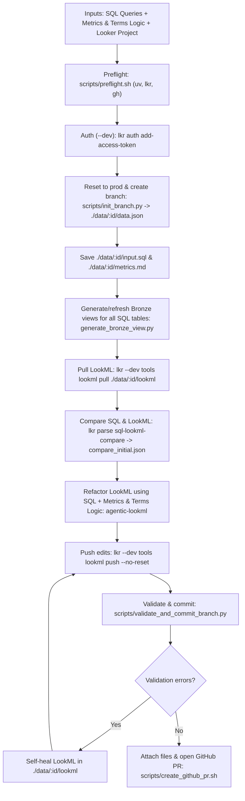

# Agentic End-to-End SQL-to-LookML Workflow (`agentic-lookml-workflow`)



## Bundled scripts

All workflow helper scripts live in `skills/agentic-lookml-workflow/scripts/`:

- [preflight.sh](scripts/preflight.sh) checks and installs `uv` if missing, installs `lkr-dev-cli[tools,code-mode,parse]` via `uv tool install`, and verifies `gh auth status` (passing `GH_TOKEN` / `GITHUB_TOKEN` directly to `gh`).
- [init_branch.py](scripts/init_branch.py) runs in `lkr code-mode sandbox --dev-mode` to fetch `me()['id']` and `git_production_branch_name`, run `reset_project_to_production`, create branch `YYYYMMDD_HHMMSS_mmm_<looker_user_id>` from the production ref, and return the base `data.json` payload.
- [validate_and_commit_branch.py](scripts/validate_and_commit_branch.py) runs in `lkr code-mode sandbox --dev-mode` to validate the project (`validate_project`) and commit the branch via the Looker API (`commit`).
- [create_github_pr.sh](scripts/create_github_pr.sh) attaches `./data/:id/input.sql`, `./data/:id/metrics.md`, `./data/:id/compare_initial.json`, and `./data/:id/compare_post_refactor.json` via `gh gist create`, writes their attachment URLs into `./data/:id/data.json`, attaches `data.json`, and opens the GitHub PR against `git_production_branch_name` via `gh pr create`.

## Workflow steps

- Collect inputs: SQL queries (inline or `.sql` files), metrics and terms logic (business definitions, common measures, and dimensions/filters used for common analysis), and the target Looker project (`BASE_URL`, `PROJECT_ID`, `MODEL_NAME`, `CONNECTION_NAME`).
- Run preflight checks ([scripts/preflight.sh](scripts/preflight.sh)) and authenticate in development mode (`--dev` is mandatory; never run in production):
  ```bash
  bash skills/agentic-lookml-workflow/scripts/preflight.sh
  lkr --client-id="$LOOKERSDK_CLIENT_ID" --client-secret="$LOOKERSDK_CLIENT_SECRET" --base-url="$BASE_URL" --dev auth add-access-token
  ```
- Reset the developer workspace to production, create branch `YYYYMMDD_HHMMSS_mmm_<looker_user_id>` off the production ref with [scripts/init_branch.py](scripts/init_branch.py), and extract `data.json`, `input.sql`, and `metrics.md` into `./data/$RUN_ID/`:
  ```bash
  BRANCH_JSON=$(lkr --base-url="$BASE_URL" --dev code-mode sandbox --dev-mode \
    --file=skills/agentic-lookml-workflow/scripts/init_branch.py \
    --var project_id="$PROJECT_ID" \
    --var ts_utc="$(date -u +%Y%m%d_%H%M%S_%3N)")
  RUN_ID=$(echo "$BRANCH_JSON" | jq -r '.run_id')
  mkdir -p "./data/$RUN_ID/lookml"
  echo "$BRANCH_JSON" > "./data/$RUN_ID/data.json"
  cp "$SQL_FILE" "./data/$RUN_ID/input.sql"
  cp "$METRICS_FILE" "./data/$RUN_ID/metrics.md"
  ```
- Run [generate-view-from-table](../generate-view-from-table/SKILL.md) ([generate_bronze_view.py](../generate-view-from-table/scripts/generate_bronze_view.py)) for all physical tables in the SQL query every time so every `bronze/:table.view.lkml` is up to date on the branch, then pull all LookML into `./data/$RUN_ID/lookml`:
  ```bash
  lkr --base-url="$BASE_URL" --dev code-mode sandbox --dev-mode \
    --file=skills/generate-view-from-table/scripts/generate_bronze_view.py \
    --var project_id="$PROJECT_ID" \
    --var model_name="$MODEL_NAME" \
    --var connection_name="$CONNECTION_NAME" \
    --var schema_name="$SCHEMA_NAME" \
    --var table_name="$TABLE_NAMES"
  lkr --base-url="$BASE_URL" --dev tools lookml pull "./data/$RUN_ID/lookml" --project-id="$PROJECT_ID"
  ```
- Run `lkr parse sql-lookml-compare`, apply [agentic-lookml](../agentic-lookml/SKILL.md) to `./data/$RUN_ID/lookml` (modeling both `input.sql` and `metrics.md`), and re-run `lkr parse sql-lookml-compare`:
  ```bash
  lkr parse sql-lookml-compare --sql-file "./data/$RUN_ID/input.sql" --path "./data/$RUN_ID/lookml" --output "./data/$RUN_ID/compare_initial.json"
  # Apply agentic-lookml refactoring in ./data/$RUN_ID/lookml
  lkr parse sql-lookml-compare --sql-file "./data/$RUN_ID/input.sql" --path "./data/$RUN_ID/lookml" --output "./data/$RUN_ID/compare_post_refactor.json"
  ```
- Push local LookML edits with `--no-reset`, validate and commit on the Looker branch via [scripts/validate_and_commit_branch.py](scripts/validate_and_commit_branch.py) (self-healing any validation errors before committing), and run [scripts/create_github_pr.sh](scripts/create_github_pr.sh) to attach the extracted files, record their attachment URLs in `./data/$RUN_ID/data.json`, and open the GitHub PR:
  ```bash
  lkr --base-url="$BASE_URL" --dev tools lookml push "./data/$RUN_ID/lookml" --project-id="$PROJECT_ID" --no-reset

  lkr --base-url="$BASE_URL" --dev code-mode sandbox --dev-mode \
    --file=skills/agentic-lookml-workflow/scripts/validate_and_commit_branch.py \
    --var project_id="$PROJECT_ID" \
    --var commit_message="feat(lookml): refactor SQL queries ($RUN_ID)"

  bash skills/agentic-lookml-workflow/scripts/create_github_pr.sh "./data/$RUN_ID"
  ```
