# Agentic end-to-end SQL-to-LookML workflow (`agentic-lookml-workflow`)

```mermaid
flowchart TD
    Start["Ask user for missing inputs: SQL Queries + Metrics & Terms Logic + Looker Project (PROJECT_ID)"] --> Preflight["Preflight: scripts/preflight.sh (uv, lkr, gh)"]
    Preflight --> Auth["Auth (--dev): lkr auth add-access-token"]
    Auth --> InitBranch["Reset to prod & create branch: scripts/init_branch.py -> ./data/:id/data.json"]
    InitBranch --> ExtractFiles["Save ./data/:id/input.sql, ./data/:id/metrics.md, initialize summary.md & pull existing LookML"]
    ExtractFiles --> ModelCheck{"Existing model or new/no model?"}
    ModelCheck -- "No models / Creating new model" --> AskConn["Ask user for CONNECTION_NAME (or offer to list instance connections), default MODEL_NAME=PROJECT_ID, create .model.lkml from examples/template.model.lkml & run scripts/configure_model.py (create_lookml_model)"]
    AskConn --> GenBronze
    ModelCheck -- "Existing model" --> GenBronze["Generate/refresh Bronze views for all SQL tables: generate_bronze_view.py (log to summary.md)"]
    GenBronze --> PullLookML["Pull generated LookML, verify model includes via lkr parse lookml & update baseline snapshots"]
    PullLookML --> GenBronzeRefinements["Deconstruct query, identify patterns, author Bronze refinements & verify includes via lkr parse lookml (log to summary.md)"]
    GenBronzeRefinements --> PushBronze["Push Bronze to dev branch: lkr --dev tools lookml push --no-reset"]
    PushBronze --> PreGate["PRE-MODELING & PRE-TEST GATE: Validate LookML + Init SQL Runner + Early Query Parity"]
    PreGate --> PreGateCheck{"Validator or parity errors?"}
    PreGateCheck -- "Yes" --> FixBronze["Log 'Validation failed' & 'Updating LookML' to summary.md; self-heal Bronze"]
    FixBronze --> PushBronze
    PreGateCheck -- "No" --> RunAgentic["Model Silver/Gold & write LookML tests (tests/) in ./data/:id/lookml (log to summary.md)"]
    RunAgentic --> SnapshotGate["Check snapshots: lkr parse lookml snapshot --allow-additions -> snapshot_check.json"]
    SnapshotGate --> PushFinal["Push final LookML to dev branch: lkr --dev tools lookml push --no-reset"]
    PushFinal --> TargetTests["Target new/additional tests via lkr code-mode: run_lookml_test(file_id=..., test=...)"]
    TargetTests --> RecordParity["Register final Explore queries: scripts/record_query_parity.py -> /x/:query_id"]
    RecordParity --> ValidateCommit["Final validation & targeted tests: scripts/validate_and_commit_branch.py"]
    ValidateCommit --> ValidCheck{"Validation or test errors?"}
    ValidCheck -- "Yes" --> FixFinal["Log failure & fix to summary.md; self-heal LookML & tests"]
    FixFinal --> PushFinal
    ValidCheck -- "No" --> OpenPR["Attach summary.md & files, open GitHub PR with query links: scripts/create_github_pr.sh"]
```



## Prerequisite setup sub-skill

If the repository has not been configured yet (or is missing `uv`, `lkr-dev-cli`, companion skills in `.agents/skills/`, an initial `.model.lkml` file, or `.github/workflows/lookml-pr-checks.yml`), run the setup sub-skill [sub-skills/setup/SKILL.md](sub-skills/setup/SKILL.md) and [scripts/setup_repo.sh](scripts/setup_repo.sh) first.

## Bundled scripts

All workflow helper scripts live in `.agents/skills/agentic-lookml-workflow/scripts/` (or `skills/agentic-lookml-workflow/scripts/` inside `lkrdev/cli`):

- [setup_repo.sh](scripts/setup_repo.sh) runs [preflight.sh](scripts/preflight.sh), installs any missing companion skills into `.agents/skills/`, installs `.github/workflows/lookml-pr-checks.yml` from [examples/lookml-pr-checks.yml](examples/lookml-pr-checks.yml), ensures `.gitignore` excludes `.env`, `data/`, and `tmp/`, and creates an initial `<model_name>.model.lkml` when `MODEL_NAME` and `CONNECTION_NAME` are provided.
- [preflight.sh](scripts/preflight.sh) checks and installs `uv` if missing, installs `lkr-dev-cli[tools,code-mode,parse]` via `uv tool install`, and verifies `gh auth status` (passing `GH_TOKEN` / `GITHUB_TOKEN` directly to `gh`).
- [init_branch.py](scripts/init_branch.py) runs in `lkr code-mode sandbox --dev-mode` to fetch `me()['id']` and `git_production_branch_name`, run `reset_project_to_production`, create branch `YYYYMMDD_HHMMSS_mmm_<looker_user_id>` from the production ref, and return the base `data.json` payload.
- [configure_model.py](scripts/configure_model.py) runs in `lkr code-mode sandbox --dev-mode` to register or update the LookML model configuration on the Looker instance via `create_lookml_model` (or `update_lookml_model`) with `allowed_db_connection_names=[connection_name]`, defaulting `model_name` to `project_id` (with hyphens replaced by underscores) when the project does not have a model yet. Pair with [examples/template.model.lkml](examples/template.model.lkml) when creating `./data/:id/lookml/<model_name>.model.lkml`.
- [init_sql_queries.py](scripts/init_sql_queries.py) runs in `lkr code-mode sandbox --dev-mode` to split multi-statement SQL in `input.sql`, create SQL Runner queries via `create_sql_query(body={"connection_name": connection_name, "sql": stmt})` by default (so query creation never fails with `400 Model ... has errors` before a new model is deployed to production), and populate `data.json["queries"]` with `0`-based `query_index`, `sql_query_id`, and `sql_runner_url` (`{BASE_URL}/sql/{sql_id}`).
- [record_query_parity.py](scripts/record_query_parity.py) runs in `lkr code-mode sandbox --dev-mode` to optionally run `validate_project` (when `--var validate="true"` is passed), register Looker explore queries via `create_query` (when `inline_queries_json` is provided, keyed by `0`-based `query_index`: `{"0": {...}}`), store `query_id`, `query_slug`, and `explore_url` (`{BASE_URL}/x/{query_slug}`), cache baseline SQL Runner rows (`sql_rows`), and compare row outputs between SQL Runner (`run_sql_query`) and Looker (`run_inline_query` / `run_query`) both locally and in CI.
- [validate_and_commit_branch.py](scripts/validate_and_commit_branch.py) runs in `lkr code-mode sandbox --dev-mode` to validate the project (`validate_project`), execute targeted LookML data tests (`run_lookml_test` filtered by `test_names` / `file_ids`, or skipped via `skip_tests="true"`), block commits if any test fails, and optionally commit (`commit`) and push (`push_branch`) the branch via the Looker API when `commit_message` is provided.
- [create_github_pr.sh](scripts/create_github_pr.sh) runs `lkr parse lookml snapshot --allow-additions` if `snapshot_check.json` is not yet generated, embeds `summary.md`, the snapshot review status, the interactive SQL Runner (`/sql/:sql_id`) and Looker Explore (`/x/:query_id`) link table, and collapsible `<details>` sections for `./data/:id/input.sql`, `./data/:id/metrics.md`, `./data/:id/snapshot_check.json`, and `./data/:id/data.json` directly in the PR description, opens the GitHub PR against `git_production_branch_name` via `gh pr create` (requesting reviewers when material snapshot changes are detected), posts `./data/:id/compare_initial.json` and `./data/:id/compare_post_refactor.json` in a collapsible `<details>` PR comment (`gh pr comment`), and writes the PR URL into `./data/:id/data.json`.

## Workflow steps

- Ask the user directly for any missing inputs on the first prompt: SQL queries (inline or `.sql` files), metrics and terms logic (business definitions, common measures, and dimensions/filters used for common analysis), and the target Looker project (`PROJECT_ID`, plus `BASE_URL` if not already configured). Do not search the local workspace or query the Looker instance to guess or discover projects unless the user asks to see a list.
- Run repository setup and preflight checks ([scripts/setup_repo.sh](scripts/setup_repo.sh) and [sub-skills/setup/SKILL.md](sub-skills/setup/SKILL.md)) to ensure `uv`, `lkr-dev-cli[tools,code-mode,parse]`, `gh`, `jq`, companion skills, and `.github/workflows/lookml-pr-checks.yml` are installed, and authenticate in development mode (`--dev` is mandatory; never run in production):
  ```bash
  bash .agents/skills/agentic-lookml-workflow/scripts/setup_repo.sh
  lkr --client-id="$LOOKERSDK_CLIENT_ID" --client-secret="$LOOKERSDK_CLIENT_SECRET" --base-url="$BASE_URL" --dev auth add-access-token
  ```
- Reset the developer workspace to production, create branch `YYYYMMDD_HHMMSS_mmm_<looker_user_id>` off the production ref with [scripts/init_branch.py](scripts/init_branch.py), initialize `data.json`, `input.sql`, `metrics.md`, and `summary.md` inside `./data/$RUN_ID/`, and pull the project's existing LookML into `./data/$RUN_ID/lookml`:
  ```bash
  RAW_BRANCH=$(lkr --base-url="$BASE_URL" --dev code-mode sandbox --dev-mode \
    --file=.agents/skills/agentic-lookml-workflow/scripts/init_branch.py \
    --var project_id="$PROJECT_ID" \
    --var ts_utc="$(date -u +%Y%m%d_%H%M%S_%3N)")
  BRANCH_JSON=$(echo "$RAW_BRANCH" | sed -n '/^{/,$p')
  RUN_ID=$(echo "$BRANCH_JSON" | jq -er '.run_id')
  mkdir -p "./data/$RUN_ID/lookml"
  echo "$BRANCH_JSON" > "./data/$RUN_ID/data.json"
  cp "$SQL_FILE" "./data/$RUN_ID/input.sql"
  cp "$METRICS_FILE" "./data/$RUN_ID/metrics.md"
  echo "# Agentic LookML operations summary (\`$RUN_ID\`)" > "./data/$RUN_ID/summary.md"
  lkr --base-url="$BASE_URL" --dev tools lookml pull "./data/$RUN_ID/lookml" --project-id="$PROJECT_ID"
  ```
- Resolve the target model (`MODEL_NAME`) and database connection (`CONNECTION_NAME`) from `./data/$RUN_ID/lookml` before generating Bronze views or running initial snapshots (so `lkr parse lookml snapshot -u` never records a synthetic `inline.model.lkml` with `connection: null`):
  - If the project already contains an existing `.model.lkml` file and you are not creating a new model, read `MODEL_NAME` and its `connection: "$CONNECTION_NAME"` declaration from the model file.
  - If the project does not have any models (`*.model.lkml`), or if you are creating a new model, set `MODEL_NAME="${PROJECT_ID//-/_}"` when no model name exists yet, and always ask the user which connection (`CONNECTION_NAME`) to use (or ask if they want to display a list of available connections from the Looker instance). After the user provides `CONNECTION_NAME`, configure the model on the Looker instance via `create_lookml_model` using [scripts/configure_model.py](scripts/configure_model.py) (create `./data/$RUN_ID/lookml/$MODEL_NAME.model.lkml` *after* running `generate_bronze_view.py` + `lookml pull` so `lookml pull` never deletes a newly created local `.model.lkml` file as a local orphan):
    ```bash
    MODEL_NAME="${MODEL_NAME:-${PROJECT_ID//-/_}}"
    lkr --base-url="$BASE_URL" --dev code-mode sandbox --dev-mode \
      --file=.agents/skills/agentic-lookml-workflow/scripts/configure_model.py \
      --var project_id="$PROJECT_ID" \
      --var model_name="$MODEL_NAME" \
      --var connection_name="$CONNECTION_NAME"
    ```
  - Whenever LookML files are generated or written in `./data/$RUN_ID/lookml`, ensure `$MODEL_NAME.model.lkml` has `include:` statements covering the written files (based on [examples/template.model.lkml](examples/template.model.lkml), including only globs that match existing files on disk so Looker's validator does not fail on empty globs), ensure every standalone `.explore.lkml` and `.test.lkml` file explicitly `include:`s its referenced `.view.lkml`, `.refinement.lkml`, or `.explore.lkml` files (because Looker's project validator validates standalone `.explore.lkml` and `.test.lkml` files in their own scope), and verify with `lkr parse lookml --path "./data/$RUN_ID/lookml"` that `model.<model_name>.view`, `model.<model_name>.explore`, and `model.<model_name>.test` pick up every written view, refinement, explore, and test present in `file.view`, `file.explore`, and `file.test`.
- Throughout the session, append high-level operation milestones to `./data/$RUN_ID/summary.md` as defined in [agentic-lookml](../agentic-lookml/SKILL.md):
  1. Generating base views (`bronze/:table.view.lkml`)
  2. Deconstructing query to canonical form (including the modeling decisions made and, whenever a derived table or Gold explore is used, the specific reason why the query could not be reduced further into a flat Canonical Looker Query)
  3. Query patterns from original query (for example, single-table with union: `simple_single_table`, `unions`)
  4. Writing LookML (Bronze refinements, hidden base explores, Silver and Gold views and explores)
  5. Validation failures (`Validation failed: ...`) and self-healing updates (`Updating LookML: ...`)
  6. Writing and targeting LookML tests (`tests/bronze/` and `tests/silver/`)
- Run [generate-view-from-table](../generate-view-from-table/SKILL.md) ([generate_bronze_view.py](../generate-view-from-table/scripts/generate_bronze_view.py)) for all physical tables in the SQL query every time so every `bronze/:table.view.lkml` is up to date on the branch, pull all LookML into `./data/$RUN_ID/lookml`, ensure `$MODEL_NAME.model.lkml` exists and includes `/bronze/**/*.view.lkml`, take the baseline snapshot (`lkr parse lookml snapshot -u`), and log the base view generation in `./data/$RUN_ID/summary.md`:
  ```bash
  lkr --base-url="$BASE_URL" --dev code-mode sandbox --dev-mode \
    --file=.agents/skills/generate-view-from-table/scripts/generate_bronze_view.py \
    --var project_id="$PROJECT_ID" \
    --var model_name="$MODEL_NAME" \
    --var connection_name="$CONNECTION_NAME" \
    --var schema_name="$SCHEMA_NAME" \
    --var table_name="$TABLE_NAMES"
  lkr --base-url="$BASE_URL" --dev tools lookml pull "./data/$RUN_ID/lookml" --project-id="$PROJECT_ID"
  LOOKML_DIR="./data/$RUN_ID/lookml" MODEL_NAME="$MODEL_NAME" CONNECTION_NAME="$CONNECTION_NAME" \
    bash .agents/skills/agentic-lookml-workflow/scripts/setup_repo.sh
  lkr parse lookml snapshot --path "./data/$RUN_ID/lookml" -u
  lkr parse sql-lookml-compare --sql-file "./data/$RUN_ID/input.sql" --path "./data/$RUN_ID/lookml" --output "./data/$RUN_ID/compare_initial.json"
  ```
- Deconstruct the SQL query to canonical form, identify the matched query patterns from the original query, author Bronze refinements (`bronze/:table.refinement.lkml`) and hidden base explores (`bronze/explores/:table_base.explore.lkml`), record these steps in `./data/$RUN_ID/summary.md`, and push Bronze files to the dev branch:
  ```bash
  lkr --base-url="$BASE_URL" --dev tools lookml push "./data/$RUN_ID/lookml" --project-id="$PROJECT_ID" --no-reset
  ```
- Generate the Explore query JSON Schema offline with `lkr parse lookml-to-api --validate` (which also fails if duplicate field logic—such as a second unfiltered `type: count` measure alongside `measure: count`—exists on any view) and `lkr schema generate`, and validate your `INLINE_QUERIES_JSON` (`run_inline_query` payloads) with `lkr schema validate` before calling Looker:
  ```bash
  lkr parse lookml-to-api --path "./data/$RUN_ID/lookml" -m "$MODEL_NAME" -e "$EXPLORE_NAME" --validate -o "./data/$RUN_ID/explore_${EXPLORE_NAME}.json"
  lkr schema generate -m "$MODEL_NAME" -e "$EXPLORE_NAME" --explore-file "./data/$RUN_ID/explore_${EXPLORE_NAME}.json" -o "./data/$RUN_ID/schema_${EXPLORE_NAME}.json"
  lkr schema validate --schema-file "./data/$RUN_ID/schema_${EXPLORE_NAME}.json" --query "$SINGLE_INLINE_QUERY_JSON"
  ```
- Execute the pre-modeling and pre-test verification gate immediately after Bronze generation and before writing tests or finalizing Silver modeling:
  1. Initialize SQL Runner queries via `init_sql_queries.py` using `--var connection_name="$CONNECTION_NAME"` (defaulting `create_sql_query` to `connection_name` rather than `model_name`) to capture `/sql/:sql_id` links in `data.json`:
     ```bash
     RAW_OUT=$(lkr --base-url="$BASE_URL" --dev code-mode sandbox --dev-mode \
       --file=.agents/skills/agentic-lookml-workflow/scripts/init_sql_queries.py \
       --var raw_sql="$(cat "./data/$RUN_ID/input.sql")" \
       --var data_json="$(cat "./data/$RUN_ID/data.json")" \
       --var base_url="$BASE_URL" \
       --var connection_name="$CONNECTION_NAME")
     JSON_OUT=$(echo "$RAW_OUT" | sed -n '/^{/,$p')
     echo "$JSON_OUT" | jq -e . >/dev/null && echo "$JSON_OUT" > "./data/$RUN_ID/data.json"
     ```
  2. Run the LookML validator and early query parity check in a single `code-mode` sandbox call via [scripts/record_query_parity.py](scripts/record_query_parity.py) with `--var validate="true"` and `0`-based `INLINE_QUERIES_JSON` keys (`{"0": {...}}` matching `query_index: 0`) before writing any tests, logging any `Validation failed` and `Updating LookML` self-healing steps to `./data/$RUN_ID/summary.md`:
     ```bash
     RAW_OUT=$(lkr --base-url="$BASE_URL" --dev code-mode sandbox --dev-mode \
       --file=.agents/skills/agentic-lookml-workflow/scripts/record_query_parity.py \
       --var data_json="$(cat "./data/$RUN_ID/data.json")" \
       --var base_url="$BASE_URL" \
       --var validate="true" \
       --var inline_queries_json="$INLINE_QUERIES_JSON")
     JSON_OUT=$(echo "$RAW_OUT" | sed -n '/^{/,$p')
     echo "$JSON_OUT" | jq -e . >/dev/null && echo "$JSON_OUT" > "./data/$RUN_ID/data.json"
     ```
- Model Silver explores, cross-view `*_fields`, and author LookML data tests (`tests/bronze/` and `tests/silver/`) in `./data/$RUN_ID/lookml` following [agentic-lookml](../agentic-lookml/SKILL.md) (never creating a duplicate field with identical logic on the same view, such as a second `type: count` measure when `measure: count { type: count }` already exists; refine `measure: count` instead, and use the Explore JSON Schema from `lkr schema generate` to verify valid `view.field` references and filter expressions for `explore_source:`), log the authored LookML and tests in `./data/$RUN_ID/summary.md`, re-run compare, and evaluate LookML snapshots with `--allow-additions` so pure additions pass automatically while any modified or removed test assert, test field, connection name, measure label, access grant, or manifest setting is flagged in `snapshot_check.json`:
  ```bash
  lkr parse lookml-to-api --path "./data/$RUN_ID/lookml" -m "$MODEL_NAME" -e "$EXPLORE_NAME" --validate -o "./data/$RUN_ID/explore_${EXPLORE_NAME}.json"
  lkr schema generate -m "$MODEL_NAME" -e "$EXPLORE_NAME" --explore-file "./data/$RUN_ID/explore_${EXPLORE_NAME}.json" -o "./data/$RUN_ID/schema_${EXPLORE_NAME}.json"
  lkr parse sql-lookml-compare --sql-file "./data/$RUN_ID/input.sql" --path "./data/$RUN_ID/lookml" --output "./data/$RUN_ID/compare_post_refactor.json"
  lkr parse lookml snapshot --path "./data/$RUN_ID/lookml" --allow-additions --format json --output "./data/$RUN_ID/snapshot_check.json" || true
  lkr parse lookml snapshot --path "./data/$RUN_ID/lookml" -u
  ```
- Push final LookML edits (including `__snapshots__/*.snap.strings.json`) to the active developer branch with `--no-reset`:
  ```bash
  lkr --base-url="$BASE_URL" --dev tools lookml push "./data/$RUN_ID/lookml" --project-id="$PROJECT_ID" --no-reset
  ```
- Register final Looker explore queries in development mode, capture `/x/:query_id` short URLs, and record final parity status:
  ```bash
  RAW_OUT=$(lkr --base-url="$BASE_URL" --dev code-mode sandbox --dev-mode \
    --file=.agents/skills/agentic-lookml-workflow/scripts/record_query_parity.py \
    --var data_json="$(cat "./data/$RUN_ID/data.json")" \
    --var base_url="$BASE_URL" \
    --var inline_queries_json="$INLINE_QUERIES_JSON")
  JSON_OUT=$(echo "$RAW_OUT" | sed -n '/^{/,$p')
  echo "$JSON_OUT" | jq -e . >/dev/null && echo "$JSON_OUT" > "./data/$RUN_ID/data.json"
  ```
- Target every new or additional test with `lkr code-mode` (`run_lookml_test` filtered by `file_ids` and `test_names`), validate syntax, commit, and push the branch to `origin` via [scripts/validate_and_commit_branch.py](scripts/validate_and_commit_branch.py) (self-healing and logging any validation or test errors in `./data/$RUN_ID/summary.md` before committing), and run [scripts/create_github_pr.sh](scripts/create_github_pr.sh) to embed `./data/$RUN_ID/summary.md`, interactive query links, and session artifacts in the PR description and open the GitHub PR:
  ```bash
  lkr --base-url="$BASE_URL" --dev code-mode sandbox --dev-mode \
    --file=.agents/skills/agentic-lookml-workflow/scripts/validate_and_commit_branch.py \
    --var project_id="$PROJECT_ID" \
    --var file_ids="$NEW_TEST_FILE_IDS" \
    --var test_names="$NEW_TEST_NAMES" \
    --var commit_message="feat(lookml): refactor SQL queries ($RUN_ID)"

  bash .agents/skills/agentic-lookml-workflow/scripts/create_github_pr.sh "./data/$RUN_ID"
  ```

## Example GitHub PR checks workflow ([examples/lookml-pr-checks.yml](examples/lookml-pr-checks.yml))

Customers can copy [examples/lookml-pr-checks.yml](examples/lookml-pr-checks.yml) into `.github/workflows/lookml-pr-checks.yml` in their LookML repository. When pull requests containing LookML changes, snapshots, or `./data/*/data.json` session files are created, updated, or reviewed, GitHub Actions runs three sequential steps in a single job:

1. The first step runs `lkr parse lookml snapshot --path "$LOOKML_DIR" --base-path "$BASE_LOOKML_DIR" --allow-additions --format json` against the base branch (`origin/${{ github.base_ref }}`). Purely additive changes (adding new tests, new assertions, new test columns or derived columns, new measures, or adding labels to previously unlabeled measures) pass automatically with `requires_review: false`. Material changes (modifying or removing an existing test assertion, modifying or removing an existing test field, changing a database connection name, changing or removing a label on an existing measure, or modifying/removing access controls or manifest entries) set `requires_review: true`, resolve the affected `.lkml` and `.snap.json` files (`material_change_files`) against `CODEOWNERS` (`required_reviewers`), post a summary of the material changes and required Code Owners, request reviews from the matched `CODEOWNERS` (plus `LOOKML_REVIEWERS` if configured), and block the check until the required Code Owners approve the PR.
2. The second step runs [scripts/validate_and_commit_branch.py](scripts/validate_and_commit_branch.py) (without `commit_message`) via `lkr --base-url="$LOOKERSDK_BASE_URL" --dev code-mode sandbox --dev-mode` to execute Looker's `validate_project` and `run_lookml_test` on the branch, failing immediately if syntax errors, broken references, or LookML data tests fail.
3. The third step runs only after the validator step succeeds, executing [scripts/record_query_parity.py](scripts/record_query_parity.py) (without `inline_queries_json`) via `lkr --base-url="$LOOKERSDK_BASE_URL" --dev code-mode sandbox --dev-mode` to compare each SQL Runner query (`/sql/:sql_id`) against its corresponding Looker explore query (`/x/:query_id`) and verify numerical parity.
