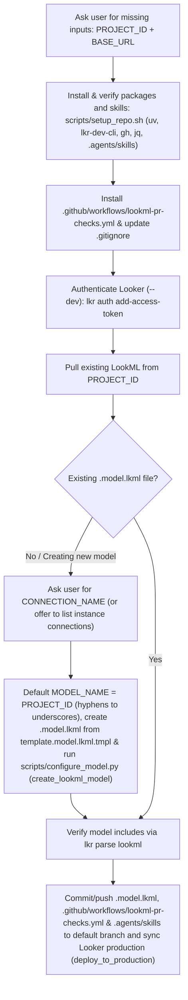

# Agentic LookML workflow repository and project setup (`agentic-lookml-workflow-setup`)

Run this setup sub-skill before your first [agentic-lookml-workflow](../../SKILL.md) session in a repository, or whenever a repository is missing CLI tools, a `.model.lkml` file, or `.github/workflows/lookml-pr-checks.yml`.



## Setup checklist

1. Ask the user directly for `PROJECT_ID` (and `BASE_URL` if not already set in `.env` or environment variables). Do not search the local workspace or query Looker to guess projects unless the user asks to see a list.
2. Run [scripts/setup_repo.sh](../../scripts/setup_repo.sh) to install or verify `uv`, `lkr-dev-cli[tools,code-mode,parse]`, `gh`, `jq`, companion skills in `.agents/skills/`, `.github/workflows/lookml-pr-checks.yml` (copied from [examples/lookml-pr-checks.yml](../../examples/lookml-pr-checks.yml)), and `.gitignore` entries (`.env`, `data/`, `tmp/`):
   ```bash
   bash .agents/skills/agentic-lookml-workflow/scripts/setup_repo.sh
   ```
3. Authenticate with Looker in development mode (`--dev` is mandatory):
   ```bash
   lkr --client-id="$LOOKERSDK_CLIENT_ID" --client-secret="$LOOKERSDK_CLIENT_SECRET" --base-url="$BASE_URL" --dev auth add-access-token
   ```
4. Check whether the project already has a `.model.lkml` file by pulling current LookML from the project:
   ```bash
   mkdir -p "./tmp/setup_lookml"
   lkr --base-url="$BASE_URL" --dev tools lookml pull "./tmp/setup_lookml" --project-id="$PROJECT_ID"
   ```
5. If no `*.model.lkml` file exists in `./tmp/setup_lookml` (or if the user wants to create a new model):
   - Default `MODEL_NAME` to `${PROJECT_ID//-/_}` (replacing hyphens `-` with underscores `_` so it is a valid Looker model identifier).
   - Always ask the user which database connection (`CONNECTION_NAME`) to use, or ask if they want to display a list of available connections from the Looker instance. If the user asks to see available connections, list them with `lkr code-mode`:
     ```bash
     lkr --base-url="$BASE_URL" --dev code-mode sandbox \
       -c '[c.get("name") for c in (all_connections() or []) if c.get("name")]'
     ```
   - Create `<model_name>.model.lkml` based on [examples/template.model.lkml.tmpl](../../examples/template.model.lkml.tmpl) using `setup_repo.sh` with `LOOKML_DIR`, `MODEL_NAME`, and `CONNECTION_NAME` (which writes `connection: "$CONNECTION_NAME"` and only includes globs matching existing files on disk so Looker validation succeeds on an empty project):
     ```bash
     MODEL_NAME="${MODEL_NAME:-${PROJECT_ID//-/_}}"
     LOOKML_DIR="./tmp/setup_lookml" MODEL_NAME="$MODEL_NAME" CONNECTION_NAME="$CONNECTION_NAME" \
       bash .agents/skills/agentic-lookml-workflow/scripts/setup_repo.sh --skip-preflight
     ```
   - Register the model and connection on the Looker instance via `create_lookml_model` (or `update_lookml_model`) using [scripts/configure_model.py](../../scripts/configure_model.py) and push `<model_name>.model.lkml` to the dev workspace:
     ```bash
     lkr --base-url="$BASE_URL" --dev code-mode sandbox \
       --file=.agents/skills/agentic-lookml-workflow/scripts/configure_model.py \
       --var project_id="$PROJECT_ID" \
       --var model_name="$MODEL_NAME" \
       --var connection_name="$CONNECTION_NAME"
     lkr --base-url="$BASE_URL" --dev tools lookml push "./tmp/setup_lookml" -f "${MODEL_NAME}.model.lkml" --project-id="$PROJECT_ID" --no-reset
     ```
   - Verify the model file parses cleanly with `lkr parse lookml`:
     ```bash
     lkr parse lookml --path "./tmp/setup_lookml"
     ```
6. Ensure `.github/workflows/lookml-pr-checks.yml`, `.agents/skills/`, `skills-lock.json`, and `<model_name>.model.lkml` are committed and merged to the repository's production branch (`git_production_branch_name`, such as `main` or `master`), and sync Looker's production copy with GitHub so every branch created by [scripts/init_branch.py](../../scripts/init_branch.py) inherits the model file and GitHub Actions workflow:
   ```bash
   lkr --base-url="$BASE_URL" --dev code-mode sandbox \
     --var project_id="$PROJECT_ID" \
     -c 'deploy_to_production(project_id=project_id)'
   ```
7. Verify that the GitHub repository has the required Actions secrets and variables configured for `.github/workflows/lookml-pr-checks.yml` (`LOOKERSDK_BASE_URL`, `LOOKERSDK_CLIENT_ID`, `LOOKERSDK_CLIENT_SECRET`, and `LOOKER_PROJECT_NAME`, plus optional `LOOKML_REVIEWERS`). Secret bootstrapping from local environment variables or `.env` is strictly opt-in during one-time repository setup (`bash .agents/skills/agentic-lookml-workflow/scripts/setup_repo.sh --sync-secrets`) and never runs automatically during PR creation:
   ```bash
   gh secret list
   gh variable list
   ```
